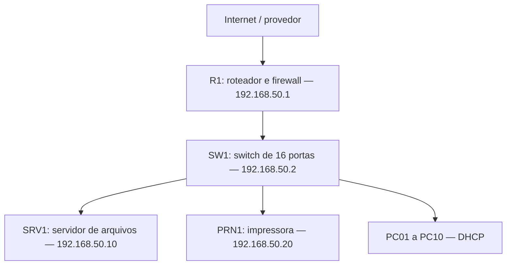

# Escopo e topologia proposta

## Cenário fictício

Uma pequena empresa utiliza dez estações Windows, uma impressora de rede e um servidor de arquivos. O modelo inicial é uma única LAN cabeada, sem Wi-Fi, VLANs, domínio Active Directory ou acesso remoto. É um ponto de partida didático; uma rede única não isola tráfego entre setores.

O enlace do provedor termina na WAN de R1. Somente a LAN usa o plano abaixo. R1 fornece DHCP e encaminhamento DNS, além de NAT para saída IPv4 e firewall sem publicação de serviços internos. O endereço WAN depende do provedor e não é inventado neste projeto.

## Recursos previstos

| Recurso | Quantidade | Função |
|---|---:|---|
| Roteador com firewall, DHCP e encaminhamento DNS | 1 | Gateway e serviços de rede |
| Switch gerenciável de 16 portas | 1 | Conexão cabeada e administração local |
| Servidor com sistema compatível com SMB | 1 | Compartilhamento autenticado |
| Estações Windows | 10 | Acesso dos usuários |
| Impressora Ethernet | 1 | Impressão local |
| Cabos Ethernet | 13 | 1 uplink, 10 PCs, servidor e impressora |

São utilizadas 13 portas do switch, restando 3 livres. Para simulação, máquinas virtuais podem representar os dispositivos; conecte-as a uma rede interna isolada. Evite modo bridge para um laboratório com DHCP próprio.

## Premissas e limites

- O roteador escolhido deve permitir configurar as funções descritas; os menus variam conforme o fabricante.
- A gestão do switch usa IP fixo e gateway local. Não faz roteamento neste desenho.
- SRV1 fornece arquivos; não é servidor DHCP, DNS ou controlador de domínio.
- DNS local para nomes de equipamentos depende de suporte específico do roteador e não é presumido. Use o IP do servidor nos testes SMB.
- Disponibilidade, orçamento, licenças, capacidade de armazenamento e desempenho exigem levantamento real antes de uma implantação produtiva.
- Há pontos únicos de falha e ausência de segmentação. Registre essas limitações na apresentação.
